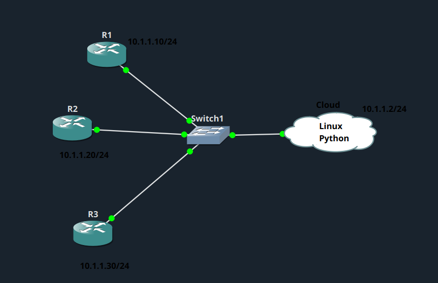
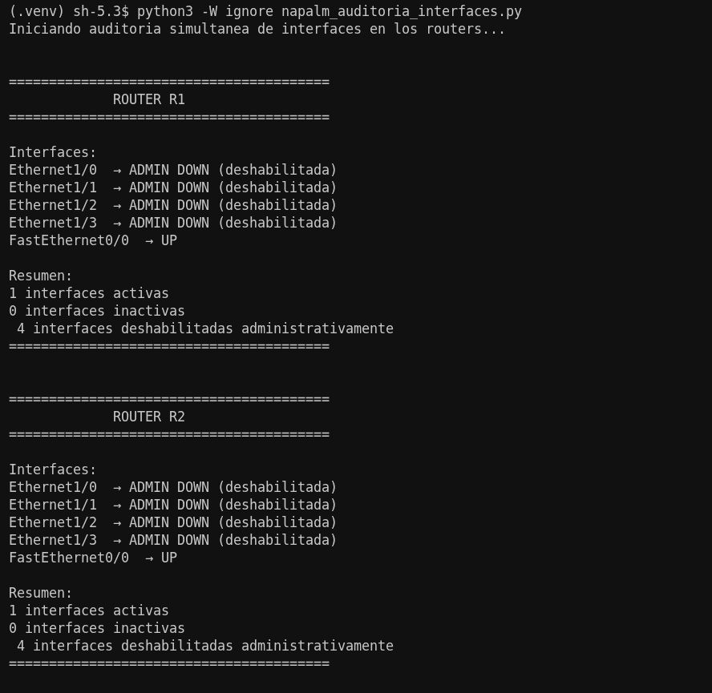

# NAPALM - Auditoría de interfaces

## Descripción

Desarrollar un script en Python que utilice **NAPALM** para conectarse simultáneamente a tres routers Cisco y comprobar el estado de sus interfaces. El programa debe identificar las interfaces activas, inactivas o administrativamente deshabilitadas, gestionar los errores de conexión y mostrar un resumen claramente separado para cada router en la terminal.

### Topología

## Explicación del script

He desarrollado el script [napalm_auditoria_interfaces.py](napalm_auditoria_interfaces.py), que realiza una auditoría simultánea de las interfaces de los tres routers mediante NAPALM. A continuación explico su funcionamiento:

- Me conecto a cada router por SSH utilizando el driver `ios` de NAPALM y obtengo el estado de sus interfaces con `get_interfaces()`.
- Clasifico cada interfaz en tres categorías: **UP** (activa), **DOWN** (inactiva) o **ADMIN DOWN** (deshabilitada administrativamente).
- Cuento el número de interfaces de cada tipo por router.
- Controlo los errores de conexión mediante un bloque `try/except`, de forma que, si un router no responde, el script muestra el motivo del fallo sin detener la ejecución del resto.
- Ejecuto las auditorías en paralelo con `ThreadPoolExecutor`, de manera que los tres routers se consultan al mismo tiempo y no de forma secuencial, reduciendo así el tiempo total del proceso.

## Resultado de la ejecución

