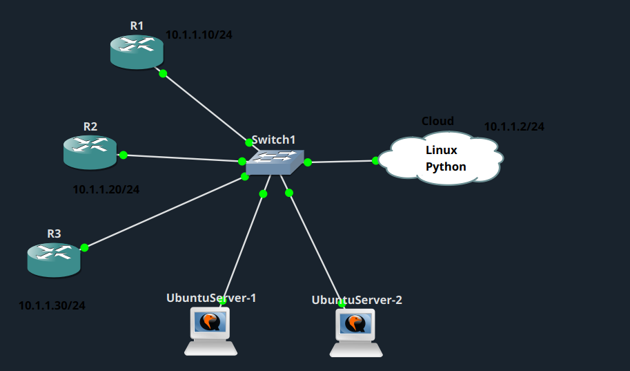
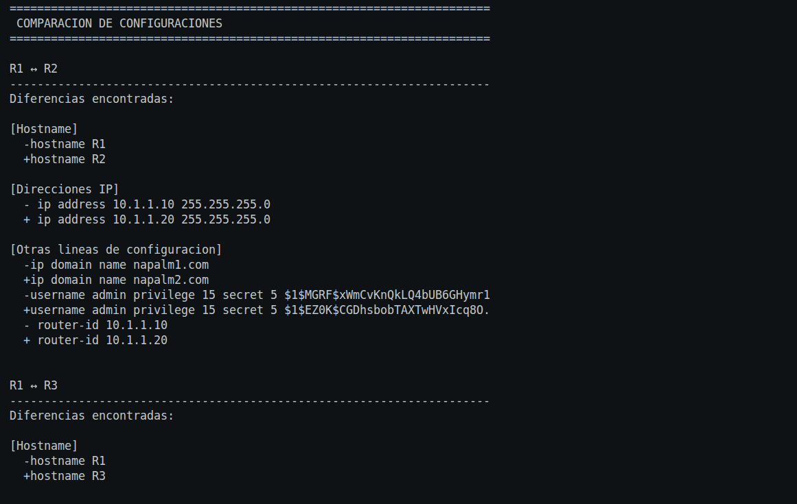

# Comparador de configuraciones con NAPALM

## Descripción del laboratorio

Este laboratorio consiste en desarrollar un script en Python que utiliza **NAPALM** y **multithreading** para conectarse de forma simultánea a tres routers Cisco (`10.1.1.10`, `10.1.1.20` y `10.1.1.30`), obtener su configuración y compararla entre ellos. El objetivo es detectar diferencias en elementos como el hostname, las interfaces o el enrutamiento, y mostrar un resumen ordenado para cada dispositivo.

### Topología

## Script

El script completo se encuentra en [`napalm_comparador_configuraciones.py`](napalm_comparador_configuraciones.py).

Mi script se conecta por SSH, mediante NAPALM, a los tres routers Cisco IOS al mismo tiempo. Para cada uno obtengo la configuración `running` y, una vez recogidas las tres, las comparo entre sí por parejas: R1 con R2, R1 con R3 y R2 con R3.

Solo muestro las líneas que son distintas entre cada par de routers, y las agrupo por categoría para que el resultado sea más fácil de leer:

- Hostname
- Interfaces
- Direcciones IP
- Routing
- Otras líneas de configuración

Al finalizar, imprimo primero el estado de conexión de cada router (si respondió correctamente o si hubo un error) y después las diferencias encontradas entre cada pareja.

## Cómo está construido

Para conectarme a los tres routers a la vez utilizo un `ThreadPoolExecutor`, que lanza la conexión a cada dispositivo en un hilo distinto. De esta forma no tengo que esperar a que un router termine para empezar con el siguiente, y los tres se consultan en paralelo.

Para cada router, guardo el resultado en un diccionario con su nombre, su IP, su configuración (si se pudo obtener), el estado de la conexión y, en caso de error, el mensaje correspondiente.

Para comparar las configuraciones utilizo la librería `difflib`, que me permite obtener únicamente las líneas que cambian entre dos configuraciones. Cada línea distinta la clasifico según su contenido (por ejemplo, si empieza por `hostname`, por `interface` o por `router`) y la agrupo en la categoría que corresponda.

## Resultado obtenido

