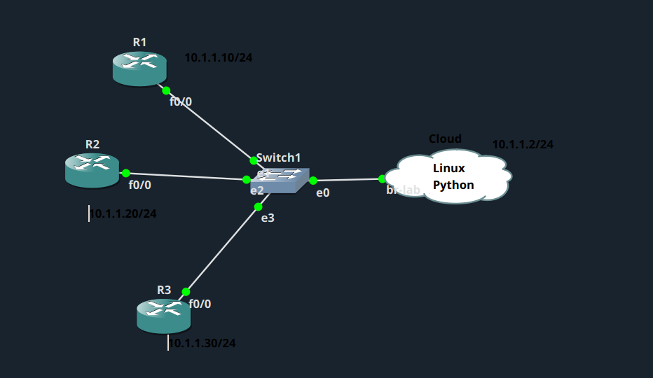
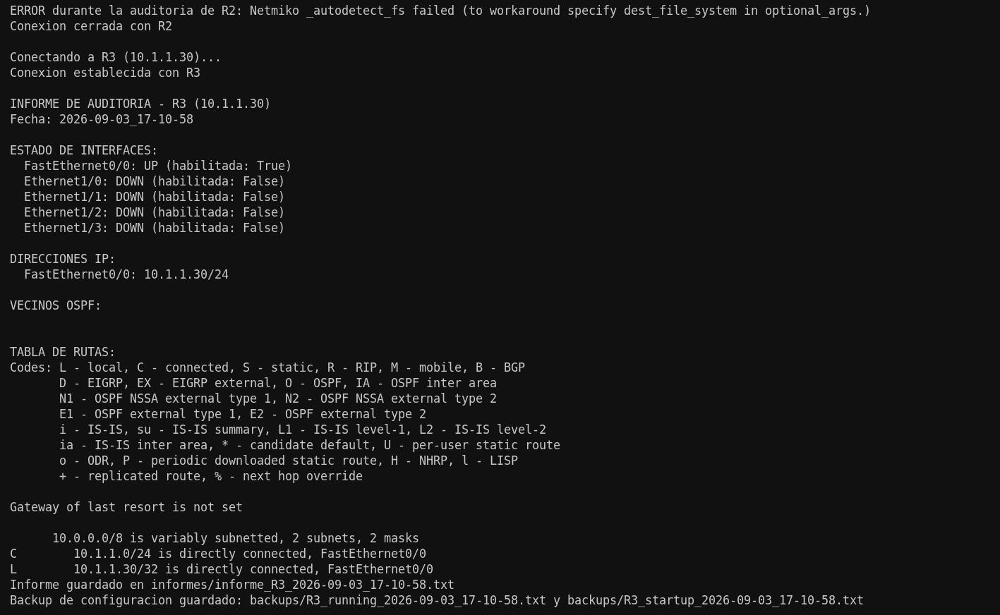
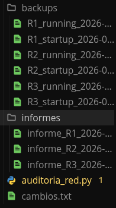

# NAPALM – Auditoría de red

## Descripción del ejercicio

Crea un programa en Python con NAPALM que se conecte a 3 routers Cisco de GNS3 y, para cada uno, obtenga interfaces, IPs y rutas, verifique el estado `up/down` de las interfaces, consulte los vecinos OSPF, genere un pequeño informe y haga backup de la configuración `running` y `startup`. Si un router no está disponible, debe gestionar el error y continuar con los demás.

## Topología utilizada



## Configuración previa de los routers

Antes de poder conectarme a los routers desde Python, tuve que preparar cada uno para aceptar conexiones SSH. No incluyo aquí la configuración completa de red, ya que alargaría demasiado este documento.

```cmd
R1(config)#hostname R1
R1(config)#ip domain name napalm1.com
R1(config)#crypto key generate rsa
R1(config)#ip ssh version 2
!
R1(config)#line vty 0 1869
R1(config-line)#login local
R1(config-line)#transport input ssh
!
R1(config)#username admin privilege 15 secret cisco
```

Repetí estos mismos pasos en R2 y R3, cambiando el nombre del host correspondiente.

## Qué hace el script

El programa principal es [auditoria_red.py](auditoria_red.py). Se conecta a los tres routers del laboratorio, uno por uno, y para cada uno realizo lo siguiente:

1. Establezco la conexión con NAPALM. Si un router no responde, muestro el error correspondiente y continúo con el siguiente sin detener la ejecución.
2. Genero un informe con el estado de las interfaces (activas o inactivas), sus direcciones IP, los vecinos OSPF y la tabla de rutas. Guardo este informe en un archivo de texto dentro de la carpeta [informes](informes/).
3. Realizo una copia de seguridad de la configuración `running` y `startup`, guardando cada una en un archivo independiente dentro de la carpeta [backups](backups/).
4. Pregunto si deseo cargar cambios de configuración desde el archivo [cambios.txt](cambios.txt). Si respondo que sí, muestro qué cambios se aplicarían y decido si los confirmo (`commit`) o los descarto (`discard`).

Al finalizar la auditoría de los tres routers, el programa muestra un mensaje indicando que el proceso ha terminado.

## Resultados obtenidos

Durante la ejecución, comprobé que el manejo de errores funciona correctamente: al simular una falla en R2, el script mostró el error y siguió con R3 sin interrumpirse.



Como resultado, obtuve los informes y las copias de seguridad de cada router, organizados en sus respectivas carpetas.


