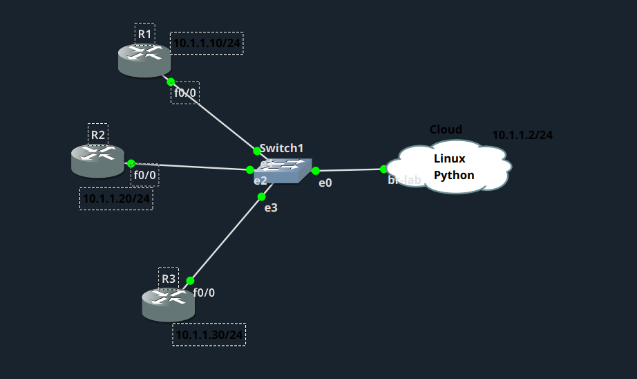
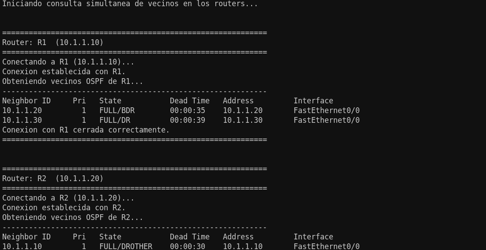

# Vecinos OSPF con NAPALM y Multithreading

## Topología

## Descripción

El objetivo de este laboratorio es desarrollar un script en Python que utilice NAPALM y multithreading para conectarse al mismo tiempo a los tres routers Cisco y obtener sus vecinos OSPF. El programa debe gestionar las conexiones de forma concurrente, controlar los posibles errores de cada equipo por separado y mostrar la información de cada router de manera clara, ordenada y visualmente separada en la terminal.

## SCRIPTS

He desarrollado dos scripts para este laboratorio. El principal utiliza NAPALM, tal y como pedía el enunciado, y un segundo script, escrito con Netmiko, lo usé antes a modo de prueba para configurar OSPF en los tres routers y comprobar que la configuración quedaba bien aplicada.

### [napalm_vecinos_multithreading.py](napalm_vecinos_multithreading.py)

Este es el script principal del laboratorio. Se conecta a los tres routers al mismo tiempo mediante un `ThreadPoolExecutor`, de forma que no espera a terminar con un router para empezar con el siguiente. En cada equipo ejecuta el comando `show ip ospf neighbor` a través de NAPALM y recoge el resultado. Si ocurre algún error de conexión en un router, lo controla de forma individual sin afectar a los demás. Al finalizar, cierra la conexión con cada equipo y muestra los resultados en bloques separados y ordenados por router.

### [configurar_ospf_routers.py](configurar_ospf_routers.py)

Este script lo usé como paso previo, para dejar OSPF configurado en los tres routers antes de probar el script de NAPALM. Con Netmiko y multithreading, se conecta a cada router, aplica la configuración de OSPF (router-id y red del área 0) y guarda los cambios. Además, verifica que la configuración se ha aplicado correctamente consultando los vecinos OSPF y las rutas aprendidas por OSPF. Esta parte de verificación es propia de este script de prueba y no está presente en el script de NAPALM.

## Pruebas

En la imagen se observa cómo el script consulta a los tres routers a la vez y muestra, para cada uno de ellos, los vecinos OSPF encontrados junto con su estado, tiempo de espera e interfaz.
