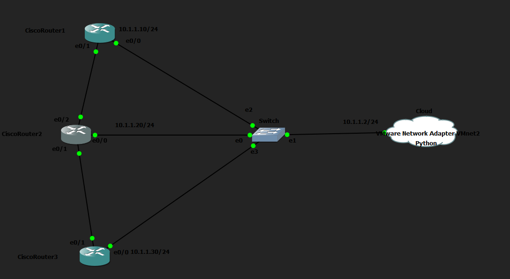
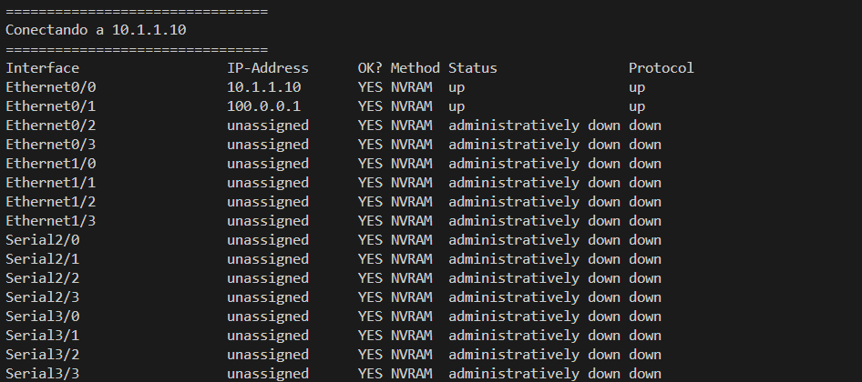

# Auditoría de Routers con Netmiko

## Descripción

En este laboratorio he desarrollado un script en Python, con la librería **Netmiko**, cuyo propósito es realizar una auditoría básica sobre varios routers Cisco mediante conexiones SSH. El programa se conecta de forma automática a los distintos dispositivos, ejecuta comandos de consulta como `show ip interface brief` y `show version`, muestra la información obtenida y cierra correctamente cada conexión.

Mi objetivo principal ha sido aprender a automatizar la gestión de múltiples dispositivos de red mediante estructuras de datos, bucles y las funciones principales de Netmiko, evitando así la necesidad de realizar estas tareas de forma manual en cada router.

## Topología

## Funcionamiento del script

El script se encuentra en [consult_routers.py](consult_routers.py) y hace lo siguiente, de forma secuencial, para cada router de la lista (`10.1.1.10`, `10.1.1.20`, `10.1.1.30`):

1. Abre una conexión SSH mediante Netmiko (`ConnectHandler`), utilizando el usuario y la contraseña definidos en el script.
2. Ejecuta el comando `show ip interface brief` y muestra el resultado completo.
3. Ejecuta el comando `show version` y muestra únicamente las líneas relevantes: versión de IOS, tiempo de actividad (uptime), imagen del sistema y memoria.
4. Cierra la conexión SSH.

## Nota sobre el diseño

Netmiko está orientado principalmente a un uso síncrono. Probé la posibilidad de emplear multithreading para conectar con varios routers en paralelo, pero descarté esta opción: la salida de los distintos hilos se mezclaba entre sí, dificultando la lectura de la información. Por este motivo, opté por un enfoque síncrono, en el que el script se conecta a cada router uno por uno, garantizando una salida clara y ordenada.

## Captura en terminal

