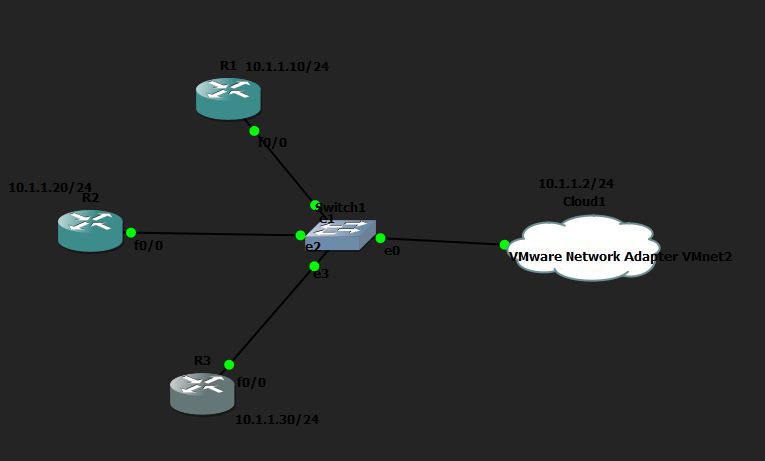
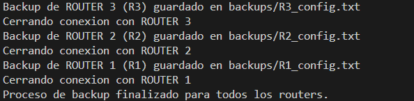
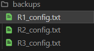
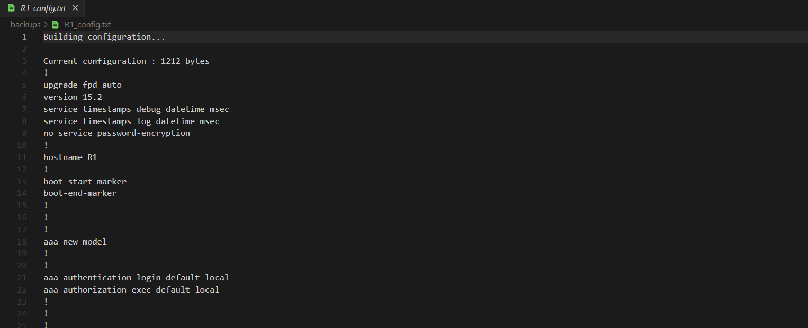

# Backup Automático de Configuración con Netmiko

## Descripción del ejercicio

Desarrolla un programa en Python utilizando **Netmiko** que se conecte a varios routers Cisco y realice automáticamente una copia de seguridad de su configuración. El programa deberá obtener la configuración actual de cada dispositivo, crear un archivo independiente para cada router y organizar los backups utilizando el hostname del dispositivo.

## Topología utilizada

## Cómo he resuelto el ejercicio

He escrito un script en Python, [backup_routers.py](backup_routers.py), que se conecta por SSH a los tres routers al mismo tiempo, utilizando hilos (threads). De este modo, no necesito esperar a que termine la conexión con un router para empezar con el siguiente.

El funcionamiento del script es el siguiente:

1. Defino una lista con los datos de conexión de cada router: dirección IP, usuario y contraseña.
2. Creo la carpeta `backups` si todavía no existe.
3. Para cada router, abro un hilo independiente que ejecuta la función `respaldar_router`. Dentro de esta función:
   - Me conecto al router mediante Netmiko.
   - Obtengo el hostname real del equipo a partir del prompt de la sesión.
   - Ejecuto el comando `show running-config` para leer la configuración actual.
   - Guardo el resultado en un archivo de texto dentro de la carpeta `backups`, con el nombre `<hostname>_config.txt` (por ejemplo, `R1_config.txt`).
   - Cierro la conexión con el router.

Para que un fallo en un router no afecte a los demás, he controlado los errores más habituales de forma independiente en cada hilo:

- **Tiempo de espera agotado** (`NetmikoTimeoutException`): el router no responde a la conexión SSH.
- **Usuario o contraseña incorrectos** (`NetmikoAuthenticationException`): fallo de autenticación.
- **Cualquier otro error inesperado**: lo capturo de forma genérica para que el script no se detenga.

En cualquiera de estos casos, muestro un mensaje de error por pantalla identificando el router afectado, pero el resto de los routers continúa con su copia de seguridad sin interrupciones.

## Resultados

Al ejecutar el script, obtengo por consola la confirmación del backup de cada router, junto con el aviso de cierre de conexión:

Como resultado final, la carpeta `backups` contiene un archivo de configuración independiente para cada router, nombrado con su hostname:

Y dentro de cada archivo encuentro la configuración completa del router correspondiente, tal y como la ha devuelto el comando `show running-config`:

