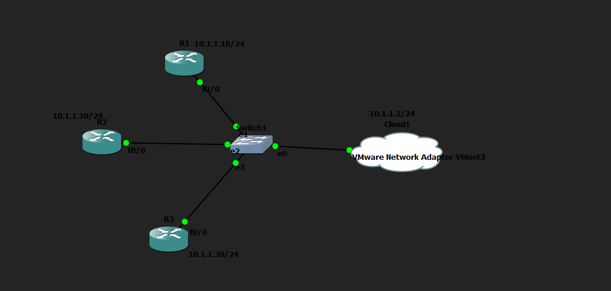
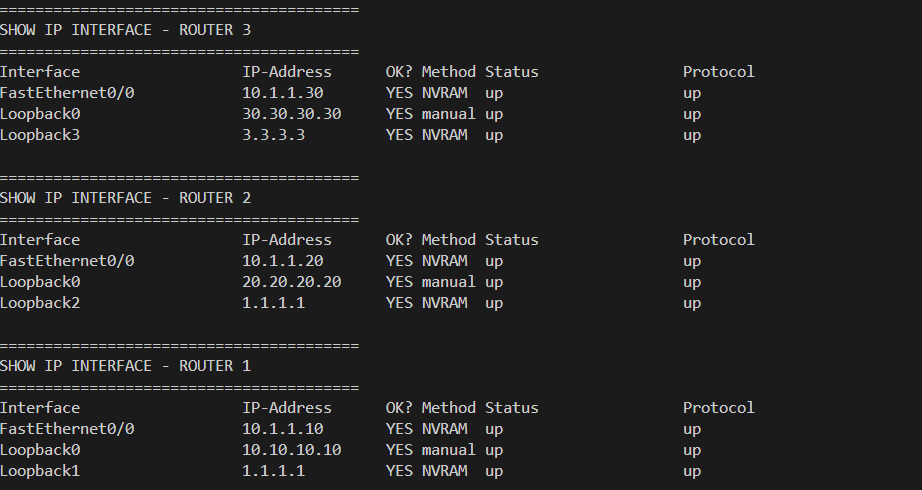
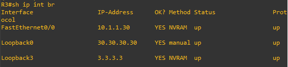

# Configuración de interfaces Loopback con Netmiko

## Descripción del ejercicio

Este ejercicio consiste en desarrollar un programa en Python, utilizando la librería Netmiko, para automatizar la configuración de interfaces en varios routers Cisco. El programa debe conectarse mediante SSH a cada dispositivo, aplicar una configuración determinada a una interfaz Loopback y, posteriormente, verificar que los cambios se hayan realizado correctamente.

## Topología

## Script

El script desarrollado se encuentra en este mismo repositorio: [netmiko_loopback_routers_multithreading.py](netmiko_loopback_routers_multithreading.py)

En términos generales, hice que el script se conectara en paralelo, mediante hilos, a los tres routers definidos en la lista `routers`. En cada uno de ellos, configuro una interfaz Loopback con la dirección IP indicada y ejecuto el comando `show ip interface brief` para comprobar el resultado. Al finalizar, imprimo la salida de cada router en un bloque independiente, identificado con su etiqueta correspondiente.

## Resultados

## Verificación

Para confirmar que la configuración se aplicó correctamente, accedí directamente a uno de los routers. Como se observa en la siguiente imagen, la interfaz Loopback quedó configurada según lo esperado. Existe una interfaz adicional que corresponde a una prueba previa que realicé con la librería Paramiko.

