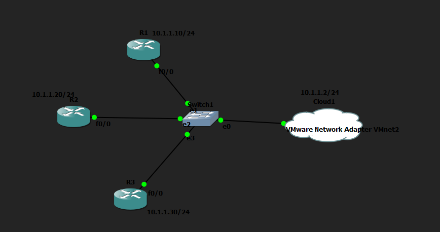
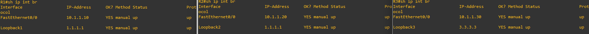

# Configuración Automática de Interfaces con Paramiko

## Objetivo

Esta práctica consiste en crear una topología en GNS3 con varios routers y utilizar Python junto con la librería `paramiko` para configurar automáticamente una interfaz Loopback en cada dispositivo. El script se conecta mediante SSH a cada router, envía los comandos de configuración y comprueba que las interfaces han quedado activas.

## Topología



## Configuración de los routers

Los tres routers utilizan una configuración equivalente: dirección IP en la interfaz `f0/0`, usuario administrativo, dominio, claves RSA para SSH y acceso por SSH en las líneas VTY.

**R1**

```text
R2(config)# int f0/0
R2(config-if)# ip add 10.1.1.10 255.255.255.0
R2(config-if)# no shut
R2(config)# username admin privilege 15 secret cisco
!
R2(config)# hostname R1
R2(config)# ip domain name python.com
R2(config)# crypto key generate rsa
R2(config)# ip ssh version 2
!
R2(config-line)# line vty 0 1869
R2(config-line)# login local
R2(config-line)# transport input ssh telnet
```

**R2**

```text
R2(config)# int f0/0
R2(config-if)# ip add 10.1.1.20 255.255.255.0
R2(config-if)# no shut
R2(config)# username admin privilege 15 secret cisco
!
R2(config)# hostname R2
R2(config)# ip domain name python2.com
R2(config)# crypto key generate rsa
R2(config)# ip ssh version 2
!
R2(config-line)# line vty 0 1869
R2(config-line)# login local
R2(config-line)# transport input ssh telnet
```

**R3**

```text
R3(config)# int f0/0
R3(config-if)# ip add 10.1.1.30 255.255.255.0
R3(config-if)# no shut
R3(config)# username admin privilege 15 secret cisco
!
R3(config)# hostname R3
R3(config)# ip domain name python3.com
R3(config)# crypto key generate rsa
R3(config)# ip ssh version 2
!
R3(config)# line vty 0 1869
R3(config-line)# login local
R3(config-line)# transport input ssh telnet
```

## Script de Python

El script utilizado está disponible en esta misma carpeta: [`multirouter_loopback.py`](multirouter_loopback.py).

En resumen, el script realiza las siguientes acciones:

1. Se conecta por SSH a varios routers en paralelo, utilizando un hilo por router.
2. Configura en cada dispositivo una interfaz Loopback con la dirección IP definida en `lista_routers`.
3. Guarda la configuración con `write memory`.
4. Comprueba con Python, leyendo la salida de `show ip interface brief`, que la Loopback ha quedado con la dirección IP correcta y en estado `up/up`.
5. Muestra al final qué routers se configuraron correctamente y cuáles fallaron.

## Verificación

La comprobación en los routers confirma que las interfaces Loopback se han creado con su dirección IP correspondiente y se encuentran activas.

