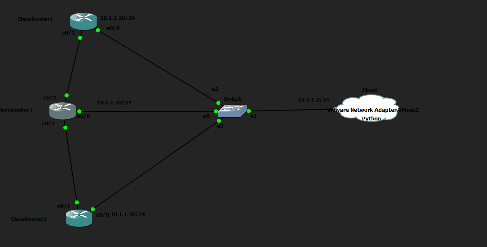
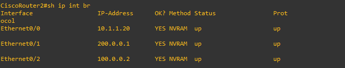

# Inventario Automático de Dispositivos de Red

## Objetivo

Esta práctica consiste en crear una topología en GNS3 con varios routers o switches y desarrollar un script en Python que recopile automáticamente información importante de cada dispositivo. El programa se conecta mediante SSH utilizando la librería `paramiko` y ejecuta diferentes comandos para obtener información como el hostname, la versión de IOS, las interfaces, sus direcciones IP y su estado. Finalmente, el script organiza los datos y genera un archivo de inventario.

## Topología

## Objetivos del ejercicio

- Crear una topología con varios dispositivos en GNS3.
- Configurar conectividad IP y acceso SSH en todos los dispositivos.
- Crear una lista o diccionario en Python con la información de conexión de cada dispositivo.
- Conectarse automáticamente a todos los dispositivos utilizando Paramiko.
- Obtener el hostname de cada dispositivo.
- Obtener información sobre la versión del sistema operativo.
- Obtener información sobre las interfaces y sus direcciones IP.
- Comprobar el estado de las interfaces.
- Guardar toda la información recopilada en un archivo.
- Generar un inventario automático de la red.

## Script de Python

El script utilizado está disponible en esta misma carpeta: [`inventario_red.py`](inventario_red.py).

El script realiza las siguientes acciones:

1. Se conecta por SSH a tres routers en paralelo, utilizando un hilo por router.
2. Obtiene de cada dispositivo el hostname, la versión de IOS y las interfaces activas.
3. Guarda toda la información en un archivo llamado `inventario_red_AAAA-MM-DD.txt`, donde `AAAA-MM-DD` es la fecha de ejecución.
4. Si un router falla, registra el error en el inventario sin interrumpir la ejecución sobre los demás dispositivos.

El inventario generado durante esta ejecución está disponible aquí: [`inventario_red_2026-08-26.txt`](inventario_red_2026-08-26.txt).

## Análisis del inventario obtenido

Al revisar el archivo generado se observan dos detalles:

- El script no ha podido obtener el hostname de los routers. Es posible que el autor original de este laboratorio (Andrei Dumitrescu) no hubiera configurado el hostname en los dispositivos.
- Dos routers muestran 2 interfaces activas, mientras que uno de ellos muestra 3 conexiones en estado *up*.

Para confirmar este último punto se ha accedido directamente al router correspondiente, y el script es correcto: la tercera interfaz activa corresponde al enlace que une R1 con R2.

