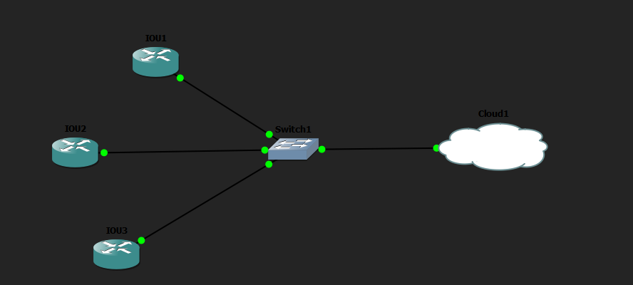
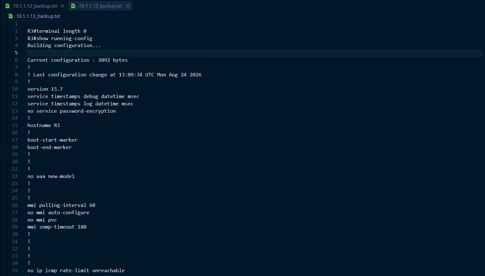

# Backup Automático de Varios Routers con Paramiko

## Objetivo

Este laboratorio practica la automatización de copias de seguridad de la configuración de varios routers utilizando **Python**, la librería `paramiko` y **GNS3**. El script se conecta automáticamente por SSH a cada router, obtiene su configuración actual y guarda una copia de seguridad en archivos independientes.

## Topología



## Objetivos del ejercicio

- Configurar varios routers en GNS3.
- Configurar el acceso mediante SSH en cada router.
- Crear conectividad entre el equipo donde se ejecuta Python y los routers.
- Crear una lista con las direcciones IP de los dispositivos.
- Utilizar Paramiko para conectarse automáticamente a cada router.
- Ejecutar el comando `show running-config`.
- Obtener la configuración de cada dispositivo.
- Guardar cada configuración en un archivo de texto independiente.
- Comprobar que los backups se han creado correctamente.

## Configuración de los routers

Los tres routers utilizan una configuración equivalente: dirección IP en la interfaz `e0/0`, nombre de host, dominio, claves RSA para SSH, usuario administrativo y acceso por SSH en las líneas VTY.

**R1**

```text
IOU1(config)# int e0/0
IOU1(config-if)# ip add 10.1.1.11 255.255.255.0
IOU1(config-if)# no shut
!
IOU1(config)# hostname R1
R1(config)# ip domain-name test1.com
R1(config)# crypto key generate rsa
R1(config)# ip ssh version 2
R1(config)# username admin privilege 15 secret cisco
!
R1(config)# line vty 0 4
R1(config-line)# login local
R1(config-line)# transport input ssh telnet
```

**R2**

```text
IOU2(config)# int e0/0
IOU2(config-if)# ip add 10.1.1.12 255.255.255.0
IOU2(config-if)# no shut
!
IOU2(config)# hostname R2
R2(config)# ip domain-name test2.com
R2(config)# crypto key generate rsa
R2(config)# ip ssh version 2
R2(config)# username admin privilege 15 secret cisco
!
R2(config)# line vty 0 4
R2(config-line)# login local
R2(config-line)# transport input ssh telnet
```

**R3**

```text
IOU3(config)# int e0/0
IOU3(config-if)# ip add 10.1.1.13 255.255.255.0
IOU3(config-if)# no shut
!
IOU3(config-if)# hostname R3
R3(config)# ip domain-name test3.com
R3(config)# crypto key generate rsa
R3(config)# ip ssh version 2
R3(config)# username admin privilege 15 secret cisco
!
R3(config)# line vty 0 4
R3(config-line)# login local
R3(config-line)# transport input ssh telnet
```

## Script de Python

El script utilizado está disponible en esta misma carpeta: [`backup_routers.py`](backup_routers.py).

El script realiza las siguientes acciones:

1. Se conecta por SSH a los tres routers (`10.1.1.11` a `10.1.1.13`).
2. Solicita a cada router el comando `show running-config`.
3. Guarda la salida en un archivo independiente con el nombre `<IP>_backup.txt`.
4. Verifica que cada archivo se haya creado correctamente.
5. Muestra al final qué backups se completaron correctamente y cuáles fallaron.

Los tres archivos de backup generados están disponibles en esta carpeta:

- [`10.1.1.11_backup.txt`](10.1.1.11_backup.txt)
- [`10.1.1.12_backup.txt`](10.1.1.12_backup.txt)
- [`10.1.1.13_backup.txt`](10.1.1.13_backup.txt)

## Resolución de problemas

Durante la ejecución surgieron problemas de conexión con los routers. El problema se resolvió ajustando el script e instalando una versión compatible de la librería:

```bash
pip install "paramiko<5"
```

Además, fue necesario ampliar los algoritmos de intercambio de claves (`kex`) aceptados por Paramiko, ya que los routers antiguos utilizan algoritmos que las versiones recientes no negocian por defecto:

```python
paramiko.Transport._preferred_kex = (
    'diffie-hellman-group14-sha1',
    'diffie-hellman-group-exchange-sha1',
    'diffie-hellman-group1-sha1',
) + paramiko.Transport._preferred_kex
```

## Resultado

La ejecución del script generó los tres archivos de backup correctamente.

