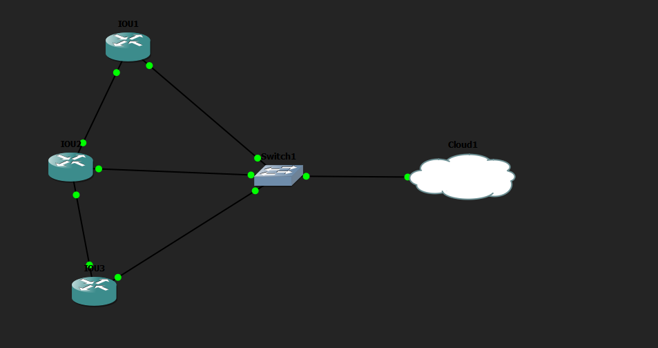
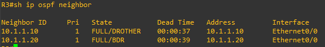

# Multiple Router Automation con Paramiko

## Objetivo

Este laboratorio practica la automatización de la configuración de varios routers mediante SSH utilizando la librería `paramiko` de Python. El laboratorio se ha realizado en GNS3.

## Topología



## Descripción del entorno

El laboratorio utiliza tres routers conectados a través de un switch hacia una nube, que es una máquina virtual con Ubuntu. Todos los dispositivos pertenecen a la red `10.1.1.0/24`.

Cada router tiene configurada su interfaz con una dirección IPv4 y permite el acceso remoto mediante SSH. Para ello, se ha completado el proceso necesario en cada dispositivo: asignar un hostname, definir un `ip domain name` y generar las claves criptográficas que requiere SSH.

Las conexiones directas entre routers que aparecen en la topología son decorativas y no cumplen ninguna función; pueden eliminarse sin afectar al laboratorio.

## Configuración de los routers

Los tres routers utilizan una configuración equivalente: dirección IP en la interfaz `Ethernet0/0`, acceso por SSH en las líneas VTY y versión 2 de SSH.

**R1**

```text
interface Ethernet0/0
 ip address 10.1.1.10 255.255.255.0
 duplex auto
!
line vty 0 4
 login local
 transport input ssh telnet
!
ip ssh version 2
```

**R2**

```text
interface Ethernet0/0
 ip address 10.1.1.20 255.255.255.0
 duplex auto
!
line vty 0 4
 login local
 transport input ssh telnet
!
ip ssh version 2
```

**R3**

```text
interface Ethernet0/0
 ip address 10.1.1.30 255.255.255.0
 duplex auto
!
line vty 0 4
 login local
 transport input ssh telnet
!
ip ssh version 2
```

## Script de Python

El script utilizado está disponible en esta misma carpeta: [`paramiko_auto1.py`](paramiko_auto1.py).

El código se conecta automáticamente por SSH a los tres routers utilizando la librería `paramiko`. Para cada router, el script realiza los siguientes pasos:

- Se conecta utilizando su dirección IP, su usuario y su contraseña.
- Entra en modo privilegiado con el comando `enable`.
- Accede al modo de configuración y configura OSPF.
- Ejecuta `show ip protocols` para comprobar la configuración.
- Muestra el resultado en pantalla.

En este laboratorio el objetivo principal es el script de Python y su funcionamiento, más que el diseño de la red.

## Resultado de la ejecución

El script configura OSPF en los tres routers con el comando `net 0.0.0.0 0.0.0.0 area 0` y comprueba el resultado con `show ip protocols`. La salida confirma que cada router tiene el protocolo `ospf 1` activo, con su Router ID correspondiente (`10.1.1.10`, `10.1.1.20` y `10.1.1.30`) y la red `0.0.0.0/0` asignada al área 0.

<details>
<summary>Salida completa del script</summary>

```text
R1#enable
R1#conf t
Enter configuration commands, one per line.  End with CNTL/Z.
R1(config)#router ospf 1
R1(config-router)#net 0.0.0.0 0.0.0.0 area 0
R1(config-router)#end
R1#terminal length 0
R1#sh ip protocols
*** IP Routing is NSF aware ***

Routing Protocol is "application"
  Sending updates every 0 seconds
  Invalid after 0 seconds, hold down 0, flushed after 0
  Outgoing update filter list for all interfaces is not set
  Incoming update filter list for all interfaces is not set
  Maximum path: 32
  Routing for Networks:
  Routing Information Sources:
    Gateway         Distance      Last Update
  Distance: (default is 4)

Routing Protocol is "ospf 1"
  Outgoing update filter list for all interfaces is not set
  Incoming update filter list for all interfaces is not set
  Router ID 10.1.1.10
  Number of areas in this router is 1. 1 normal 0 stub 0 nssa
  Maximum path: 4
  Routing for Networks:
    0.0.0.0 255.255.255.255 area 0
  Routing Information Sources:
    Gateway         Distance      Last Update
  Distance: (default is 110)

Connecting to 10.1.1.20

R2#enable
R2#conf t
Enter configuration commands, one per line.  End with CNTL/Z.
R2(config)#router ospf 1
R2(config-router)#net 0.0.0.0 0.0.0.0 area 0
R2(config-router)#end
R2#terminal length 0
R2#sh ip protocols
Routing Protocol is "ospf 1"
  Router ID 10.1.1.20
  Number of areas in this router is 1. 1 normal 0 stub 0 nssa
  Routing for Networks:
    0.0.0.0 255.255.255.255 area 0
  Distance: (default is 110)

Connecting to 10.1.1.30

R3#enable
R3#conf t
Enter configuration commands, one per line.  End with CNTL/Z.
R3(config)#router ospf 1
R3(config-router)#net 0.0.0.0 0.0.0.0 area 0
R3(config-router)#end
R3#terminal length 0
R3#sh ip protocols
Routing Protocol is "ospf 1"
  Router ID 10.1.1.30
  Number of areas in this router is 1. 1 normal 0 stub 0 nssa
  Routing for Networks:
    0.0.0.0 255.255.255.255 area 0
  Distance: (default is 110)
```

</details>

## Comprobación final

