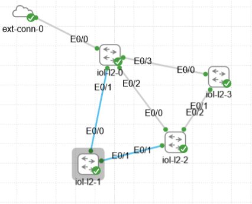
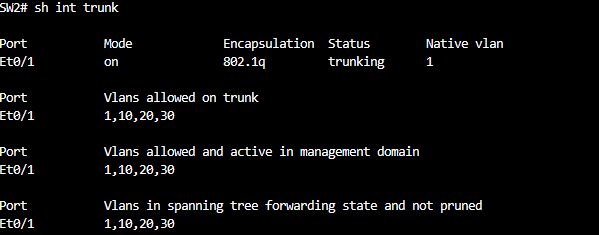
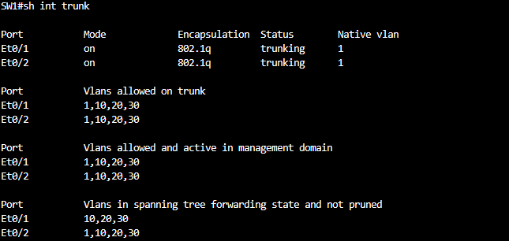
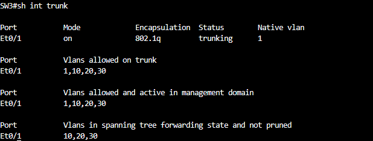

# Configuración automática de VLANs en varios switches

Este proyecto muestra cómo automatizar la creación y configuración de VLANs en varios switches Cisco mediante un script en Python. El script utiliza la librería Paramiko para conectarse por SSH a cada equipo y aplicar la configuración de forma remota, sin necesidad de introducir los comandos manualmente en cada switch.

## Objetivo de la práctica

El objetivo es construir una topología formada por varios switches y utilizar Python junto con Paramiko para automatizar la creación de VLANs. El script debe conectarse por SSH a cada switch, crear las VLANs necesarias asignándoles un nombre, configurar determinados puertos como puertos trunk y comprobar, mediante comandos de verificación, que la configuración se ha aplicado correctamente.

## Topología



## Configuración inicial de los switches

Antes de ejecutar el script, cada switch debe tener una configuración básica que permita el acceso por SSH. A continuación se muestra la configuración aplicada a los tres switches de la práctica (SW1, SW2 y SW3):

```cmd
inserthostname-here(config)#hostname SW2
SW2(config)#ip domain name test2.com
SW2(config)#username admin privilege 15 secret cisco
SW2(config)# int vlan 1
SW2(config-if)#ip add 192.168.1.15 255.255.255.0
SW2(config-if)#no shut
SW2(config)#crypto key generate rsa
SW2(config)#line vty 0 4
SW2(config-line)#login local
SW2(config-line)#transport input ssh
!
inserthostname-here(config)#hostname SW1
SW1(config)#ip domain name test1.com
SW1(config)#username admin privilege 15 secret cisco
SW1(config)#int vlan 1
SW1(config-if)#ip add 192.168.1.16 255.255.255.0
SW1(config-if)#no shut
SW1(config)#crypto key generate rsa
SW1(config)#ip ssh version 2
SW1(config)#line vty 0 4
SW1(config-line)#login local
SW1(config-line)#transport input ssh
!
inserthostname-here(config)#hostname SW3
SW3(config)#ip domain name test3.com
SW3(config)#username admin privilege 15 secret cisco
SW3(config)#int vlan 1
SW3(config-if)#ip add 192.168.1.17 255.255.255.0
SW3(config-if)#no shut
SW3(config)#crypto key generate rsa
SW3(config)#ip ssh version 2
SW3(config)#line vty 0 4
SW3(config-line)#login local
SW3(config-line)#transport input ssh
```

## Descripción del script

El script se encuentra en el archivo [configurar_vlans_trunks_switches.py](configurar_vlans_trunks_switches.py) de este mismo repositorio. Su funcionamiento es el siguiente:

- Se conecta por SSH a varios switches Cisco al mismo tiempo, mediante el uso de hilos independientes.
- En cada switch, crea las VLAN 10, 20 y 30 y les asigna un nombre.
- Configura determinados puertos como puertos trunk.
- Permite el paso de las VLAN 1, 10, 20 y 30 por dichos puertos trunk.
- Guarda la configuración en la memoria del equipo.
- Comprueba que las VLANs y los puertos trunk se hayan configurado correctamente.
- Al finalizar, muestra un resumen con los switches que se configuraron correctamente y los que presentaron algún error.

## Comprobación de resultados

A continuación se muestran las capturas que confirman que la configuración se aplicó correctamente en los switches:







## Problemas encontrados

Durante la realización de esta práctica surgió una dificultad relacionada con la experiencia previa que tuve con Cisco Packet Tracer, una herramienta menos exigente que un entorno más cercano a la realidad. Por este motivo, no se incluyó inicialmente el comando `switchport trunk encapsulation dot1q` en la configuración de los puertos.

Esta omisión provocaba que las VLANs se crearan correctamente mediante el script, pero los puertos trunk no llegaban a formarse, ya que no se había habilitado la encapsulación dot1Q. La solución consistió en añadir dicho comando al script.