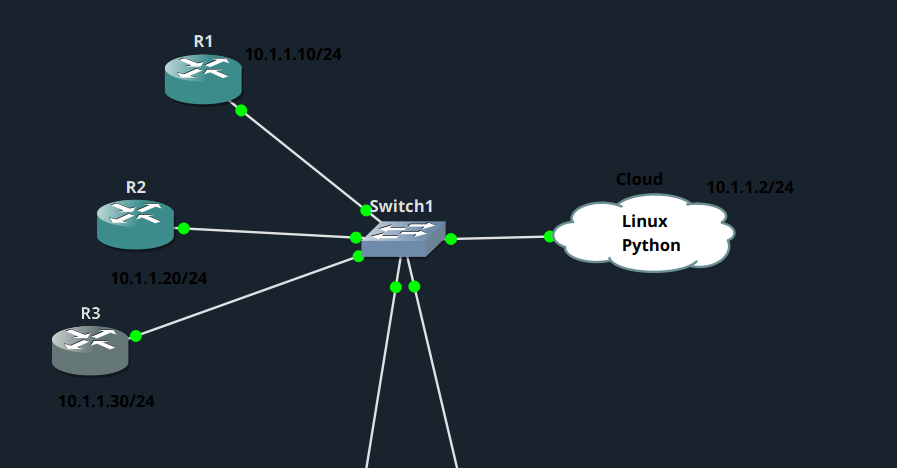
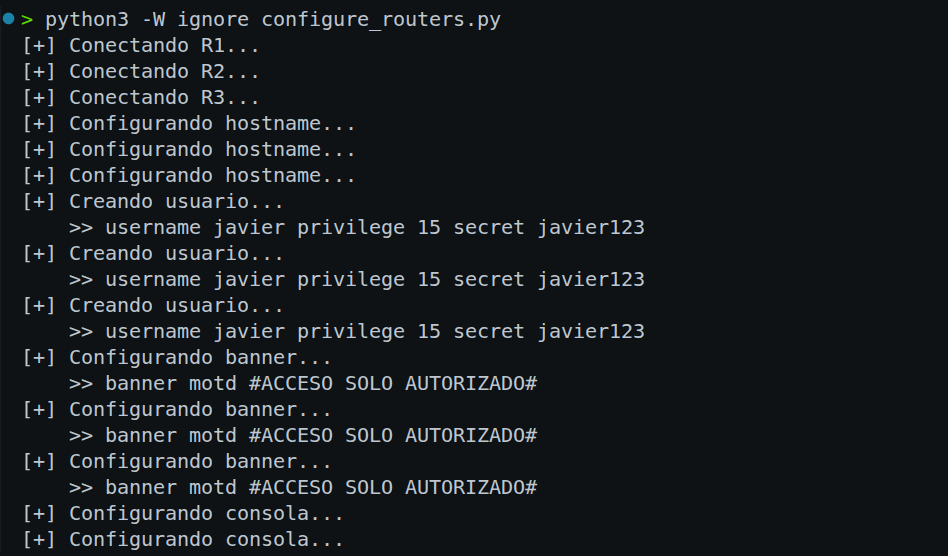

# Configuración de usuarios y acceso por consola en 3 routers

## Topología

## Descripción del laboratorio

Este laboratorio consiste en desarrollar un script en Python que se conecta por consola Serial a tres routers Cisco mediante la librería PySerial. El objetivo es automatizar la configuración del hostname, un usuario local, el banner MOTD y la autenticación de la consola. La configuración de los tres dispositivos se ejecuta de forma concurrente mediante multithreading, manteniendo una salida en terminal clara y ordenada. Al finalizar, el programa muestra el resultado de la configuración de cada router y gestiona correctamente los posibles errores de conexión.

## Script

El script utilizado en este laboratorio se encuentra en [configure_routers.py](configure_routers.py).

Me conecto en paralelo, con un thread por router, a R1, R2 y R3 a través de sus pseudo puertos serie (`/home/javinet/ttyS0/1/2`), conectados mediante socat a la consola Telnet de GNS3. En cada conexión filtro los bytes de negociación de Telnet y espero a que aparezca el prompt `Rx#`, sin utilizar el modo enable. Después entro en configure terminal, donde configuro el hostname, creo el usuario local con username y secret, defino el banner motd y activo login local en line console 0. Al terminar, salgo del modo de configuración, ejecuto show run | include hostname como verificación y cierro la conexión. Utilizo un Lock para evitar que los tres threads mezclen sus mensajes en pantalla, y al final muestro un resumen con el resultado, OK o ERROR, de cada router.

## Problemas encontrados

Tuve problemas con la negociación de Telnet.

## Pruebas

