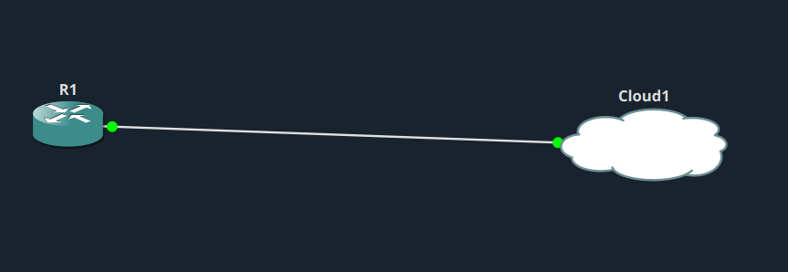
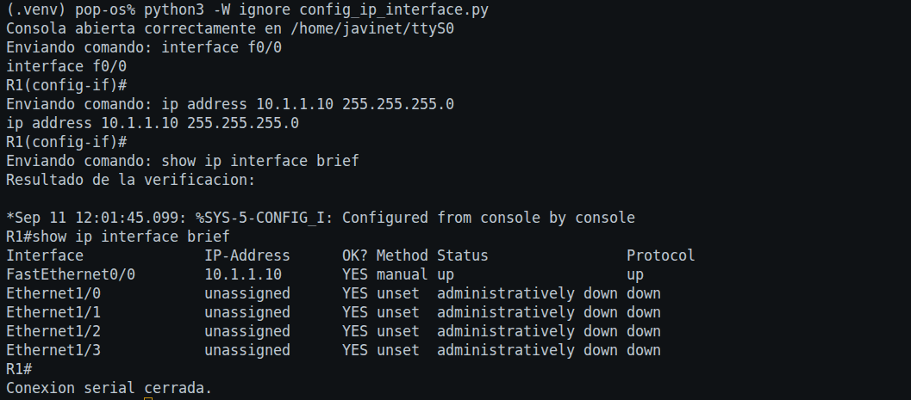
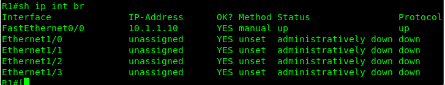

# IP Config - Serial Connection

## Descripción del lab

El objetivo de este lab es desarrollar un script en Python que permita conectarse a un router Cisco mediante una conexión de consola serial, utilizando la librería PySerial. El programa debe acceder al modo de configuración y asignar una dirección IP a la interfaz FastEthernet0/0. A continuación, debe habilitar la interfaz mediante el comando `no shutdown`. Por último, debe ejecutar el comando `show ip interface brief` para comprobar que la configuración se ha aplicado correctamente.

## Topología

## Script

El script utilizado en este lab es [config_ip_interface.py](config_ip_interface.py).

Cómo funciona el script:

- Abro el serial port (`/home/javinet/ttyS0`, a 9600 de baud rate) para comunicarme con el router como si estuviera en la consola.
- Entro en enable mode y desactivo el paginado, sin mostrar estos comandos en pantalla.
- Entro en configuration mode y, desde ahí, en la interfaz `f0/0`.
- Asigno la IP address `10.1.1.10` con máscara `255.255.255.0` y ejecuto `no shutdown` para levantar la interfaz.
- Salgo del modo de configuración y espero unos segundos a que la interfaz quede activa.
- Ejecuto `show ip interface brief` para verificar que la IP se ha configurado correctamente y que la interfaz está en estado `up/up`.

En pantalla solo muestro tres cosas: el momento en el que entro en la interfaz, el momento en el que asigno la IP, y el resultado final de la verificación. El resto de comandos (`enable`, `exit`, etc.) se ejecutan, pero no se imprimen, para no llenar de ruido la consola.

## Resultados

