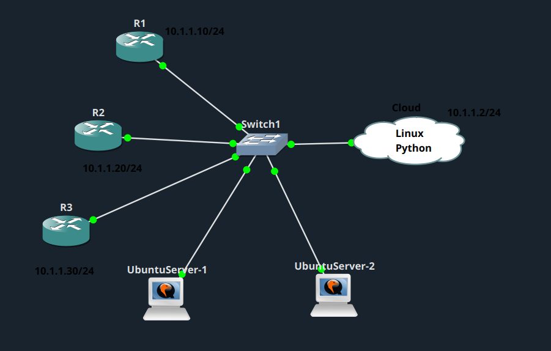
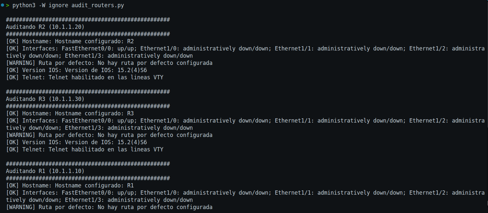
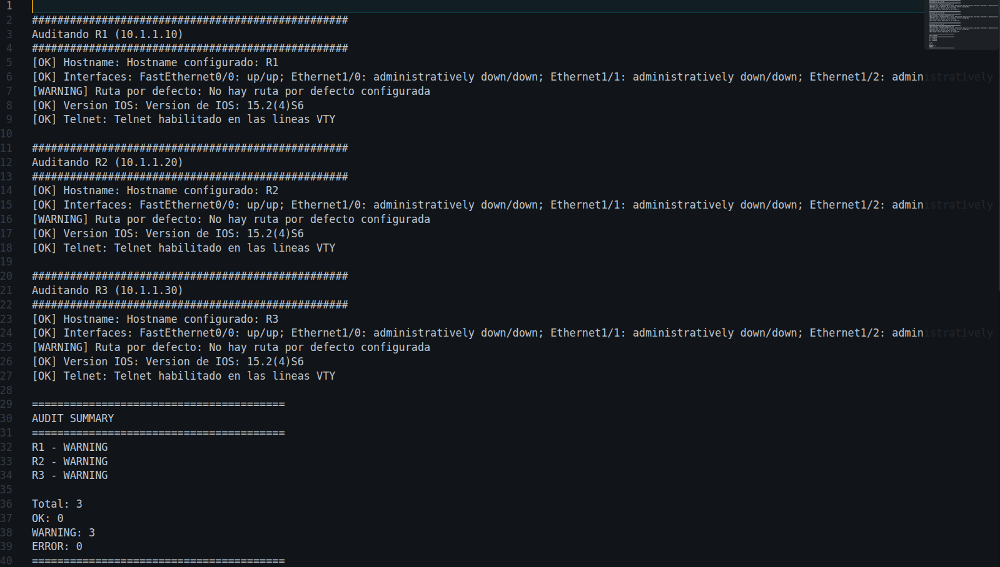

# Auditoría automática de routers

## Descripción del lab

Este lab consiste en un script en Python que realiza una auditoría de varios routers Cisco mediante Telnet. El programa se conecta a los routers de forma concurrente utilizando multithreading, y recopila información del estado de interfaces, rutas, versión de IOS y configuración. Los resultados se muestran claramente separados para cada router en la terminal, y al finalizar se presenta un resumen general del estado de todos los dispositivos.

### Topología

## Qué hace el script

Desarrollé este script para realizar una auditoría de salud (health check) de los routers, comprobando que estén bien configurados. En concreto:

1. Me conecto a la vez a los tres routers, usando varios hilos (threads) en paralelo, de modo que no espero a que termine uno para pasar al siguiente.
2. En cada router ejecuto varios comandos: `show running-config`, `show ip interface brief`, `show ip route` y `show version`.
3. Con esa información reviso cinco aspectos:
   - Que el router tenga un hostname configurado.
   - Que las interfaces de red estén up (en funcionamiento), avisando si alguna está caída sin haberla apagado a propósito.
   - Que tenga una ruta por defecto configurada.
   - Qué versión de IOS tiene.
   - Si Telnet está habilitado en las líneas de acceso remoto (un aviso de seguridad, ya que Telnet no es un protocolo seguro).
4. Por cada comprobación, marco el resultado como OK o WARNING (o ERROR si no logré conectarme).
5. Al final, genero un resumen general (cuántos routers están OK, con avisos o con error) y lo guardo en un archivo `audit_report.txt`, además de mostrarlo en pantalla.

El script se encuentra en [`audit_routers.py`](audit_routers.py).

## Resultados

### Resultado en la terminal

### Archivo de reporte generado

