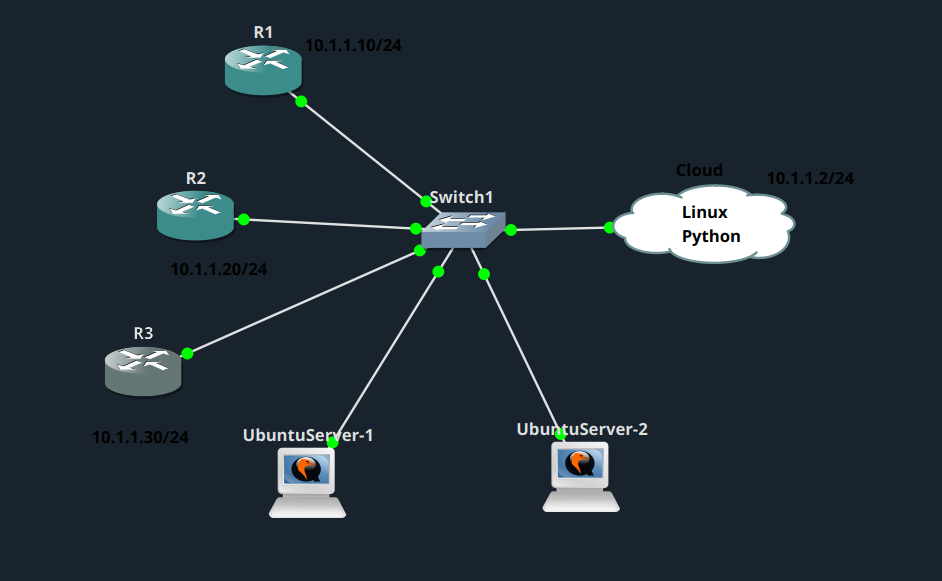
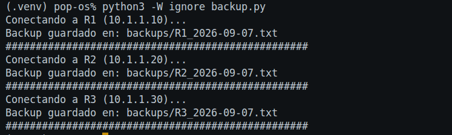

# Backup de configuración de routers Cisco vía Telnet

## Descripción del lab

Este lab consiste en desarrollar un script en Python que permite realizar automáticamente copias de seguridad de la configuración de varios routers Cisco mediante una conexión Telnet.

El programa se conecta a cada router, accede al modo privilegiado, obtiene la configuración mediante `show running-config` y guarda cada backup en un archivo independiente dentro de una carpeta `backups`, incluyendo el nombre del router y la fecha.

## Topología

## Script

1. Defino una lista de routers (R1, R2, R3) con su nombre e IP.
2. Me conecto a cada uno por Telnet, usando un usuario y una contraseña fijos (`admin`/`cisco`).
3. Una vez dentro, pido la configuración actual del router con el comando `show running-config` y espero unos segundos a que llegue toda la respuesta.
4. Guardo esa configuración en un archivo de texto dentro de la carpeta `backups/`, con un nombre del tipo `R1_2026-09-07.txt`, y le añado una cabecera con el hostname, la IP y la fecha.
5. Repito este proceso para cada router de la lista. Si la conexión con alguno falla, muestro un mensaje de error y continúo con el siguiente router, sin detener todo el proceso.

El script se encuentra en el archivo [`backup.py`](backup.py).

## Resultado de la ejecución

Como se observa en la captura, me he conectado correctamente a los tres routers y he guardado cada backup en la carpeta `backups/` con el formato `<hostname>_<fecha>.txt`.
